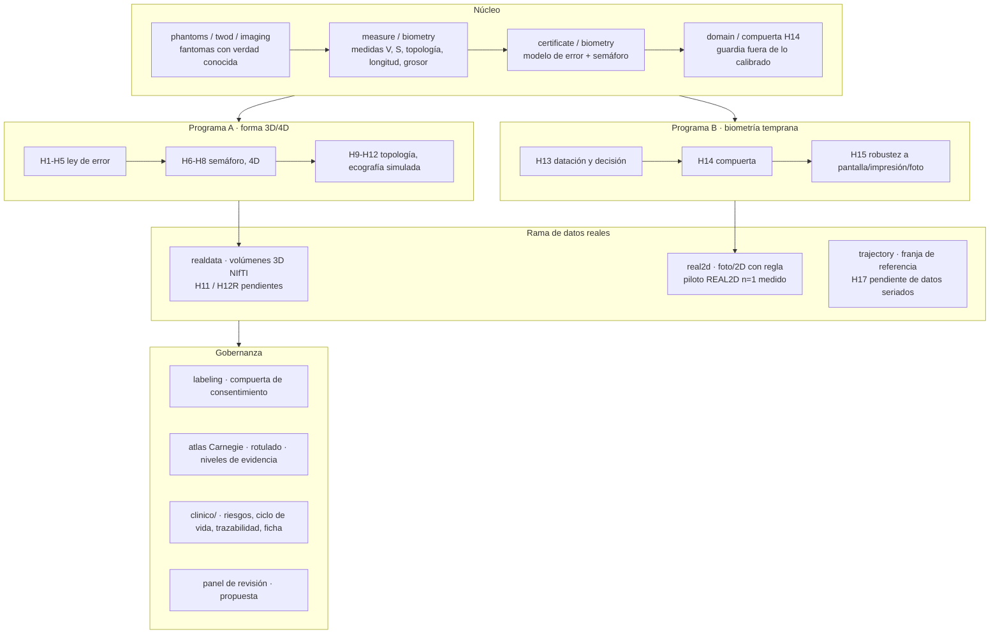

# Arquitectura del programa «Geometría de la Vida» (geovida)

> Solo investigación y educación. Un único programa con un núcleo (instrumento + certificado), dos programas de investigación, una rama de datos reales y un paquete de gobernanza.
> **Validado con imagen real: nada todavía** (una imagen medida en el piloto REAL2D, n = 1, sin validar).

## Dónde está cada cosa

| Capa | Módulos | Documentos | Estado |
|---|---|---|---|
| Núcleo | `phantoms`, `twod`, `imaging`, `measure`, `segment`, `certificate`, `domain`, `biometry` | `docs/METODOS.md`, `docs/clinico/FICHA_DEL_MODELO.md` | Probado en simulación |
| Programa A | `h3`…`h12`, `growth`, `traj4d`, `scaleaxis`, `topomargin` | `RESULTADOS_V02`…`V05` | Confirmatorio en simulación |
| Programa B | `dating`, `atlas`, `biometry`, `h13`, `h14`, `h15` | `RESULTADOS_V06`, `PREREGISTRO_H13/H14/H15` | Confirmatorio en simulación |
| Datos reales | `realdata` (3D), `real2d` (2D), `trajectory` (franja de referencia) | `GUIA_DATOS_REALES`, `REAL2D_METODO`, `PREREGISTRO_REAL2D_PILOTO`, `PREREGISTRO_H11`, `PREREGISTRO_H12R` | Código listo; **sin imágenes reales medidas** |
| Acuerdo y color | `agreement` (solapamiento, distancia de contorno, Bland–Altman), `colorbar` (linealiza un mapa de color con la barra de la captura) | `INTEGRACION_PDF_EXTERNO`, `RESULTADOS_V09` | Probado con datos sintéticos; sin comparaciones reales |
| Gobernanza | `labeling`, `provenance` | `ATLAS_ESTADIOS`, `PANEL_DE_REVISION`, `clinico/*`, `ERRATA`, `RUTA_DE_VALIDACION_REAL` | Borrador; el panel no existe |
| Interfaces | `cli` (`plan`, `datasheet`, `certify`, `real2d`, `trajectory`) | `README`, laboratorio y exposición (v0.4), visor Unity sin compilar | Parcial |

## Principios que atraviesan todo

1. **Preregistrar antes de mirar**; lo que se ve antes se declara y se prueba con semilla nueva.
2. **Abstenerse es un resultado**: fuera de lo calibrado, el certificado se niega a dar verde.
3. **La simulación no se vende como real**: sobre imagen real el semáforo no sale verde hasta validar.
4. **Los errores propios se publican** (`ERRATA.md`), con causa y prevención.
5. **Privacidad por diseño**: nada identificable en el repositorio; los informes no llevan nombres ni rutas.
