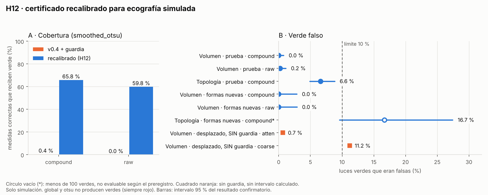

# Resultados de v0.5 (H12): recalibrar el certificado para ecografía simulada

Ocho hipótesis (H12a–H12h), con criterios y predicciones confirmados en git antes de calibrar
(`PREREGISTRO_H12.md`, commit 74668b7) y el modelo congelado en el commit 35f84aa antes de los barridos
de confirmación. **Todo es simulación.** Describe el instrumento de medida frente a un simulador de
ecografía hecho por este proyecto, no ecografía real ni biología. La hipótesis primaria es **H12c**.
Solo investigación y educación; nada de esto autoriza ningún uso clínico.

| Hipótesis | Qué dice | Veredicto |
|---|---|---|
| H12a | v0.4 sin guardia da verdes falsos en ecografía simulada | **No apoyada** (los 2 estratos evaluables dan 0.6 % y 0.5 %) |
| H12b | La guardia distingue las dos modalidades en ambos sentidos (9 comprobaciones) | Apoyada (9 de 9) |
| **H12c** (primaria) | Verde falso ≤ 10 % con la luz emitida | **Apoyada**, pero solo en 2 de 6 estratos (los otros 4 nunca dan verde) |
| H12d | Discriminación y calibración (AUC ≥ 0.85 y ECE ≤ 0.10) | **Parcial** (3 de 4 pares evaluables) |
| H12e | Vale en formas nunca vistas (mancuerna y copa) | Apoyada en volumen; la topología no es evaluable (66 verdes) y su estimación puntual supera 10 % |
| H12f | Con guardia, el dominio desplazado se rechaza o es seguro | Apoyada, de forma trivial: la guardia rechazó todo el volumen |
| H12g | La guardia hace falta (sin ella, el semáforo falla) | Apoyada **por un margen mínimo** (1 de 2 estratos evaluables; 11.2 %) |
| H12h | Recalibrar paga (más medidas correctas reciben verde) | Apoyada (≈ 60–66 % frente a ≈ 0 %) |

## Qué es lo que se hizo

* **Simulador de ecografía** (`geovida.imaging`): atenuación exponencial con la profundidad, moteado
  multiplicativo de desarrollo completo (campo gaussiano complejo suavizado, intensidad con media 1)
  y ruido aditivo. Cuatro perfiles: `us_compound` (8 «miradas» de moteado promediadas) y `us_raw` (3) para calibrar;
  `us_atten` (atenuación 1.0 en lugar de 0.3) y `us_coarse` (PSF 2.5 y grano 3.0 en lugar de 1.5) como
  dominios desplazados. Los
  perfiles anteriores producen exactamente las mismas imágenes que antes (una prueba compara huellas).
* **Calibración** (semilla 20261131, 14 400 filas, 10 réplicas, ocho niveles de resolución): se ajustaron
  modelos de volumen por segmentador y perfil, un modelo de topología elegido por validación cruzada
  dejando una forma fuera (T4: 0.0637 de entropía cruzada media, frente a 0.0640 de T7 y 0.1233 de la
  profundidad sola) y las envolventes del guardián, con las filas verdes de la calibración.
* **Confirmación** (semilla 20261132 para `test` y `unseen`, 20261133 para `shift`): 14 400 + 2 304 +
  4 320 filas nuevas, sin reajustar nada.

## H12c — Verde falso con luz emitida (primaria)

Por construcción, el certificado es evaluable donde emite al menos 200 luces verdes. Solo `smoothed_otsu`
cumple:

| Estrato | Extremo | Luces verdes | Verde falso (IC 95 %) | Cobertura | Conserva la guardia |
|---|---|---|---|---|---|
| smoothed_otsu · compound | volumen | 486 | 0.0 % (0.0–0.8) | 65.8 % | 95.9 % |
| smoothed_otsu · compound | topología | 622 | 6.6 % (4.9–8.8) | 71.2 % | 96.1 % |
| smoothed_otsu · raw | volumen | 494 | 0.2 % (0.0–1.1) | 59.8 % | 97.4 % |
| smoothed_otsu · raw | topología | 0 | — | 0 % | — |
| global · compound / raw | ambos | 0 | — | 0 % | — |
| otsu · compound / raw | ambos | 0 | — | 0 % | — |

* **Cobertura** = de las medidas correctas (|error de volumen| ≤ 5 %, o triple de Betti correcto), la
  fracción que recibe verde.
* **Por qué `global` y `otsu` nunca dan verde:** el moteado les deja un sesgo de volumen que no
  desaparece al mejorar la resolución, y el modelo lo sabe. Entre las medidas de `global` y `otsu`
  solo entre 0.3 % y 7.3 % tienen el volumen dentro de 5 %. Ponerlas en rojo es el resultado correcto,
  pero significa que **en ecografía el instrumento solo certifica un segmentador de tres**.
* La regla de la primaria exige que **todos** los estratos con un extremo evaluable cumplan: lo hacen
  los dos estratos evaluables; los cuatro restantes quedan «no evaluables», que no es lo mismo que
  «cumplen».

## H12a y H12b — La guardia y la modalidad

* **H12a no apoyada.** Mi predicción previa (12 % de que fuera apoyada) acertó, pero el razonamiento que
  daba antes del piloto estaba equivocado: creía que v0.4, sin guardia, daría muchos verdes falsos en
  ecografía. No fue así. Con el perfil `realistic` declarado y sin guardia, en `smoothed_otsu`: 490 verdes
  de volumen con 0.6 % de falsos (`compound`) y 445 con 0.5 % (`raw`). Lo que hace v0.4 con la ecografía
  es **dejarla fuera de dominio**: su guardia solo acepta 0.3 % de las imágenes de `smoothed_otsu`
  (11.6 % en `global` y 4.6 % en `otsu`). Con guardia deja 3 verdes de volumen en `compound` (ninguno
  falso; cobertura 0.4 %) y ninguno en `raw`.
  v0.4 es seguro pero vacío en ecografía.
* **H12b apoyada (9 de 9).** La guardia de v0.4 acepta como máximo 11.6 % de las imágenes de ecografía,
  y la guardia recalibrada acepta como máximo 0.22 % de las imágenes gaussianas de v0.4. Cada guardia
  reconoce a la otra modalidad como ajena.

## H12d — Calibración

De seis pares previstos, solo cuatro tienen al menos 200 filas y clase minoritaria ≥ 5 %: pasan tres
(`smoothed_otsu` en `compound` y `raw` para volumen, y `compound` para topología, con AUC entre 0.974 y
0.985 y ECE entre 0.021 y 0.026). Falla `otsu · compound` en volumen: **AUC 0.530**, ECE 0.047, es decir,
sin capacidad de distinguir. El criterio del preregistro («≥ 5/6 apoyada, ≥ 4/6 parcial») se aplicó
como proporción sobre los cuatro pares existentes; 3/4 queda en «parcial».

## H12e — Formas nunca vistas (mancuerna y copa)

* **Volumen:** `smoothed_otsu · compound` 130 verdes, 0 falsos (IC 0.0–2.9 %); `smoothed_otsu · raw` 129
  verdes, 0 falsos (0.0–2.9 %). Apoyada.
* **Topología:** `smoothed_otsu · compound` emite 66 luces verdes (por debajo del mínimo de 100), con
  16.7 % falsas (IC 9.6–27.4 %). **No hay veredicto de topología**, pero la estimación puntual es mala.
  Desglose exploratorio por forma: **mancuerna 11 falsos de 30 verdes (36.7 %)**, copa 0 de 36. Coincide
  con v0.4, donde la mancuerna ya era la forma más débil.

## H12f y H12g — Dominio desplazado

| Estrato desplazado | Verdes de volumen con guardia | Verdes de volumen sin guardia | Verde falso sin guardia |
|---|---|---|---|
| smoothed_otsu · `us_atten` | 0 | 151 | 0.7 % |
| smoothed_otsu · `us_coarse` | 0 | 134 | **11.2 %** |
| global y otsu (4 estratos) | 0 | 0 | — |

* **H12f** se cumple porque con guardia no queda ningún verde de volumen (0 de 4 320 filas desplazadas):
  seguro, pero también vacío. En topología, con guardia quedan 3 verdes (`smoothed_otsu · us_atten`) y
  ninguno es falso.
* **H12g** se cumple por el mínimo: 1 de los 2 estratos evaluables supera 10 %, y lo hace con 11.2 %.
  Donde no hay guardia, `us_atten` da 0.7 % de verdes falsos. La afirmación «el volumen necesita guardia»
  descansa, por tanto, en un solo estrato y en un margen pequeño.
* **Exploratorio, sin veredicto (menos de 100 verdes):** el certificado de topología de v0.4 sin guardia,
  sobre estas imágenes desplazadas, emitió 39 verdes con 97.4 % falsos (`us_atten`) y 26 con 100 %
  (`us_coarse`). Con guardia, 3 verdes y 0 falsos. Es la evidencia más fuerte de que la guardia importa,
  pero no alcanza el tamaño mínimo que fijé.

## H12h — Recalibrar paga

De las medidas con volumen correcto, recibe verde el 65.8 % (`compound`) y el 59.8 % (`raw`) con el
certificado recalibrado, frente al 0.4 % y 0 % de v0.4 con su guardia, y con verde falso de 0.0 % y
0.2 %. Es la mejora que justifica H12: v0.4 era seguro y vacío; el recalibrado es seguro y deja de estar
vacío en un segmentador.

## Lo que hay que leer con cuidado (descriptivo, sin veredicto)

1. **Un segmentador de tres.** `global` y `otsu` quedan en rojo en toda la ecografía simulada. El
   certificado hace bien en negarse, pero el instrumento no ayuda a quien use esos dos métodos.
2. **Una envolvente estrecha.** La guardia acepta alrededor de un tercio de las imágenes de
   `smoothed_otsu` (32.6 % en `compound`, 33.3 % en `raw`) y, para topología, 49.6 % en `compound` y 0 % en `raw`
   (sin envolvente). Cualquier ecografía con otro nivel de ruido o de nitidez queda fuera.
3. **Topología de la mancuerna.** 36.7 % de falsos verdes en formas de dos lóbulos unidos por un cuello
   fino. No es un veredicto preregistrado (menos de 100 verdes), pero es la señal de seguridad más
   clara de H12.
4. **Dos hipótesis apoyadas con poco margen.** H12f es trivial (todo rechazado) y H12g depende de un
   solo estrato con 11.2 %.
5. **`smoothed_otsu · us_raw` no da ninguna luz verde de topología** (0 de 2 400 en `test` y 0 de 384 en
   formas nuevas). Con 3 «miradas» en lugar de 8, el modelo de topología nunca llega a p ≥ 0.90; no
   investigué por qué.
6. **Los fallos silenciosos de topología se concentran en pocos casos.** De las 13 405 medidas con
   topología incorrecta, el 0.36 % tuvo probabilidad ≥ 0.90 antes de la guardia, pero esa cifra está
   dominada por `global` y `otsu`, donde casi todo falla y el modelo lo sabe. La cifra honesta para
   `smoothed_otsu · compound` es la de arriba: 6.6 % de verdes falsos de topología.
7. **El simulador es mío.** Moteado de desarrollo completo, PSF gaussiana, atenuación exponencial y
   ruido aditivo. No se comparó con ninguna ecografía real. H12 mide si el certificado se calibra
   respecto de **este** simulador, no si el simulador se parece a un equipo de alta frecuencia.
8. **Nada de esto es una validación clínica.** Una luz verde sigue siendo una estimación calibrada con
   un simulador.

## Mis predicciones, puntuadas

| Predicción (escrita después del piloto, antes de calibrar) | Probabilidad | Resultado |
|---|---|---|
| `global` y `otsu` sin verdes de volumen | 90 % | Sí |
| Al menos un estrato evaluable en `test` | 92 % | Sí (2) |
| H12a apoyada | 12 % | No (acierto) |
| H12b apoyada (9 de 9) | 85 % | Sí |
| H12c apoyada, dado que es evaluable | 65 % | Sí |
| H12d apoyada | 35 % | No: parcial (acierto) |
| H12e apoyada | 40 % | Sí en volumen (fallo de la predicción) |
| H12e no evaluable | 25 % | No (acierto) |
| H12f apoyada | 70 % | Sí |
| H12g apoyada | 55 % | Sí, por el mínimo |
| H12h apoyada, dado que es evaluable | 90 % | Sí |
| `smoothed_otsu · us_raw` sin verdes de topología evaluables | 70 % | Sí |

Puntaje de Brier 0.093 (0.250 sería decir siempre 50 %). Once de doce en el lado correcto; la excepción
es H12e, a la que di 40 % y salió apoyada en volumen.

## Qué no se puede concluir

* Nada sobre ecografía real. Si en H11 y H12R la guardia recalibrada rechaza la ecografía real, se
  aprende que el simulador no se le parece, y el siguiente paso será calibrar con volúmenes reales
  validando por embrión.
* Que un segmentador «funcione» en ecografía: H12 mide si el certificado sabe cuánto fiarse.
* Nada sobre personas ni sobre uso clínico.

## Procedencia y desviaciones

* Barrido de calibración: commit 74668b7, árbol limpio, 1 560 s. Barrido `test`: commit 35f84aa (el
  que congela el modelo, SHA-256 del archivo `c5100049…ceb`), árbol limpio, 1 509 s. Barridos `unseen`
  (884 s) y `shift` (477 s): commit 24df964, árbol limpio; entre 35f84aa y 24df964 solo cambió `docs/`
  (no hay diferencias en `src`, `scripts` ni `pyproject.toml`).
* Los resultados salen de `scripts/analyze_h12.py` (veredictos en `results/summary/h12_verdicts.json`,
  tablas en `results/summary/h12_*.csv`) y la figura de `scripts/figure_h12.py`.
* Para H12b(ii) se usó el barrido de confirmación de v0.4 ya existente (`h9_test.csv.gz`, semilla
  20261124).
* **Desviaciones: ninguna** de los criterios. Una aclaración: el denominador de H12d fue cuatro (no seis)
  porque solo cuatro pares cumplían el mínimo de filas y de clase minoritaria; se aplicó el criterio
  como proporción.
* Reproducir: `python scripts/run_h12.py --set cal` → `python scripts/calibrate_h12.py` → los barridos
  `test`, `unseen`, `shift` → `python scripts/analyze_h12.py`.
