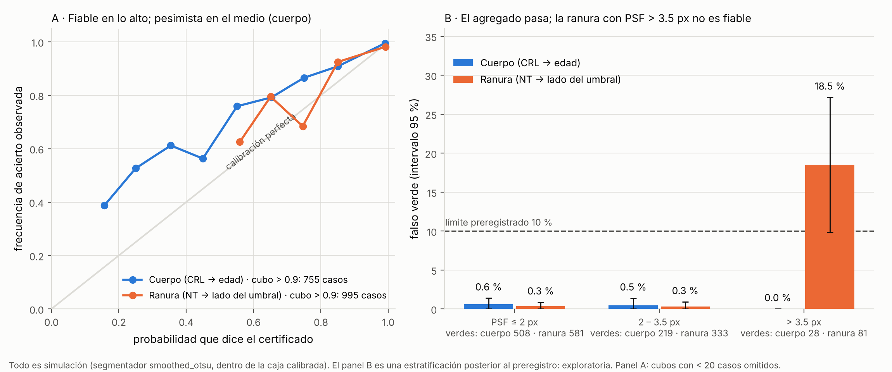

# Resultados v0.6 — H13: biometría fetal temprana con certificado de incertidumbre (Programa B)

> Solo investigación y educación. **Todo es simulación**: fantomas 2D sintéticos, ninguna ecografía de
> personas ni de animales. Nada de esto es evidencia clínica. Reglas fijadas en `docs/PREREGISTRO_H13.md`
> (commit 0932c51, antes de calibrar). Modelos congelados: `results/summary/h13_frozen.json`, SHA-256
> `60943f48…315b0a` (commit b27443f). Confirmación con semilla 20261213, código limpio en el commit 9d14b15.

## 1. Resumen honesto

* **Los cuatro criterios confirmatorios se cumplieron en el agregado**, con `smoothed_otsu` y dentro de la caja
  calibrada. Mi predicción para esto era más pesimista (ver §5).
* **Pero el agregado esconde un estrato donde el certificado de la ranura no es fiable**: con función de
  dispersión de más de 3.5 px hay 18.5 % de falsos verdes (15 de 81; IC 95 % 9.9–27.2 %). Es una estratificación
  **posterior** al preregistro, así que es exploratoria; aplicando la regla de H13 a ese estrato daría
  «no concluyente» (el límite inferior, 9.9 %, queda justo bajo el 10 %), pero la tasa es la peor de todo el estudio.
* **El control `otsu` falla en la ranura** (30.3 % de falsos verdes; IC 23.2–37.7 %): con ese segmentador el
  certificado no se puede usar.
* **Una datación certificada no es una datación correcta.** En mediana la medida pone el 0.9 % de la varianza de
  la edad; el resto es la variación biológica de la fórmula (unos 3 días a 45 mm).

## 2. Resultados confirmatorios (reglas de antemano)

| Hipótesis | Resultado | Veredicto |
|---|---|---|
| **H13a** Datación: falso verde ≤ 10 % | 755 verdes de 1 500; **0.53 %** [0.13–1.10] | **apoyada** |
| **H13b** Decisión: falso verde ≤ 10 % | 995 verdes de 1 500; **1.81 %** [0.99–2.69] | **apoyada** |
| **H13c** ECE ≤ 0.10 | cuerpo **0.081** [0.066–0.098] (n = 1 487); ranura **0.036** [0.026–0.049] (n = 1 252) | **apoyada** |
| **H13d** Fuga de la guardia ≤ 5 % | cuerpo 0/400 [0–0]; ranura 4/400 = **1.0 %** [0.25–2.0] | **apoyada** |
| **H13e** Frente a un operador (descriptiva) | ver §4 | sin criterio |
| **H13f** Peso de la medida en la datación (descriptiva) | ver §4 | sin criterio |

Matices que importan:

* **H13c**: en el cuerpo el ECE queda cerca del límite (0.081; el IC llega a 0.098). El error es de **pesimismo**:
  en probabilidades de 0.15 a 0.75 el acierto observado es mayor que el dicho (panel A). Es un error del lado seguro,
  pero cuesta cobertura: 450 de 1 500 casos de cuerpo quedaron en amarillo y 295 en rojo.
* **H13d**: sin guardia (un modelo que lleva el caso al borde de la caja y predice ahí) la ranura habría tenido
  **11.6 %** de falsos verdes fuera de lo calibrado (34 de 293), el cuerpo 1.1 % (2 de 187). La guardia importa
  sobre todo en la ranura. De los 4 verdes que se filtraron, 1 estaba equivocado (n = 4: no informa).
* **Sin certificado dentro de la caja**: cuerpo 13 casos, ranura 248 (la medida arrojó un `n` fuera de lo calibrado).
  Cuentan como amarillo.
* Los casos se muestrearon log-uniformes dentro de la caja. **La tasa de falso verde depende de cómo se reparten
  las condiciones reales**: si el uso se concentra en PSF grande, el agregado engaña.

## 3. Lo que falla (hallazgos no preregistrados, exploratorios)

**Estratos por ancho de la función de dispersión** (`results/summary/h13_strata.csv`, `smoothed_otsu`):

| Tipo | PSF ≤ 2 px | 2 – 3.5 px | > 3.5 px |
|---|---|---|---|
| Cuerpo | 0.6 % (508 verdes) | 0.5 % (219) | 0.0 % (28) |
| Ranura | 0.3 % (581) | 0.3 % (333) | **18.5 % (81)** [9.9–27.2] |

**Control `otsu`** (mismas reglas, solo informativo): cuerpo 108 verdes, 0 equivocados; ranura 155 verdes, **30.3 %**
equivocados. De los 1 500 casos de ranura dentro de la caja, 1 238 no recibieron certificado.

**Mecanismo (hipótesis apoyada por las 15 filas de `results/summary/h13_wrong_greens.csv`, no probada):**

1. En esas celdas la ranura casi no se halla: la fracción de medidas dentro de la mitad de la verdad es de 9–42 %
   con PSF = 5 px (`results/summary/h13_usable_rate_by_cell.csv`). El error es bimodal, y un modelo de sesgo y
   desviación normal lo describe mal.
2. El `n` del certificado sale de **la medida**. En 4 de los 15 casos la segmentación devolvió un fragmento de ≈ 1 mm
   (n medido 11–14 px, con n verdadero ≈ 45): el modelo se consulta en la celda equivocada, donde la desviación es
   pequeña, y declara verde con p = 1.0.
3. En los otros 11, la medida sobreestima; el modelo resta el sesgo negativo de la celda (−0.6 a −2.5 mm) y cree que
   el valor verdadero está lejos del umbral, cuando estaba cerca (2.3–3.3 mm).

La guardia protege contra el `n` que se sale de la caja, **no contra un `n` mal estimado dentro de ella**.

## 4. Descriptivas (sin criterio)

* **H13e — NT simulada frente a repetibilidad humana publicada** (error tras corregir el sesgo modelado; 0.25 mm y
  0.40 mm son la desviación de una sola medición, a partir de PubMed 10895448): en los 995 verdes la mediana del error
  absoluto es 0.058 mm, el percentil 95 es 1.32 mm, el 84 % queda dentro de 0.25 mm y el 89 % dentro de 0.40 mm. La
  cola es pesada: cerca de 1 de cada 9 verdes tiene un error corregido mayor que 0.40 mm (aunque el lado del umbral casi
  siempre sale bien porque esos casos están lejos del umbral). **No se puede decir «mejor que un operador»**: la tarea,
  la imagen, el píxel y la forma son otros.
* **H13f — peso de la medida en la datación** (1 487 certificados): mediana 0.9 %, percentil 90 de 30 %; en 3.8 % de los
  casos la medida pone más de la mitad de la varianza de la edad.

## 5. Mis predicciones

| Predicción | Probabilidad | Ocurrió |
|---|---|---|
| H13a apoyada | 85 % | sí |
| H13b apoyada | 55 % | sí |
| H13c apoyada | 45 % | **sí** (lado equivocado) |
| H13d apoyada en cuerpo / ranura | 90 % / 35 % | sí / **sí** (lado equivocado en la ranura) |
| El modelo sin guardia supera 10 % de falso verde en la ranura | 60 % | sí (11.6 %) |
| Mediana del error de la NT en los verdes < 0.25 mm | 80 % | sí (0.058 mm) |
| Mediana de la parte de varianza de la medida < 0.25 | 90 % | sí (0.009) |

Ocho de ocho ocurrieron; 6 de 8 del lado correcto; **Brier medio 0.146**. Fui más pesimista de lo que el simulador
justificaba. No se interpreta como que el método sea mejor de lo pensado: los criterios agregados son más fáciles de
cumplir que los estratos, y el simulador es mío.

## 6. Qué se puede concluir y qué no

**Sí (en este simulador):** con `smoothed_otsu`, dentro de la caja calibrada y repartiendo las condiciones como aquí, el
certificado de datación y el de decisión tuvieron falsos verdes de 0.5 % y 1.8 %, y su probabilidad estuvo razonablemente
calibrada; la guardia rechazó 99 % de lo no calibrado.

**No:**

* Nada sobre ecografía real. El moteado, la relación PSF–píxel y la ranura limpia son supuestos sin validar.
* Nada de la ranura con PSF > 3.5 px, ni de `otsu`.
* Nada sobre exactitud del grosor en milímetros: una cola de errores > 0.4 mm convive con un lado del umbral casi siempre bien.
* El umbral de 3.0 mm es ilustrativo; no se evaluó rendimiento de cribado.
* Una datación certificada no es una datación correcta: domina la variación biológica.

## 7. Siguiente paso

El mecanismo apunta a una corrección concreta, que **es otra hipótesis y exige otro preregistro y otra semilla**:
una compuerta de «tasa de medidas utilizables» por celda (rechazar donde la medida suele fallar) y un `n` que no dependa
de la medida que se está certificando. Después, ecografía real de animal con referencia (H11/H12R) cuando haya volúmenes.
