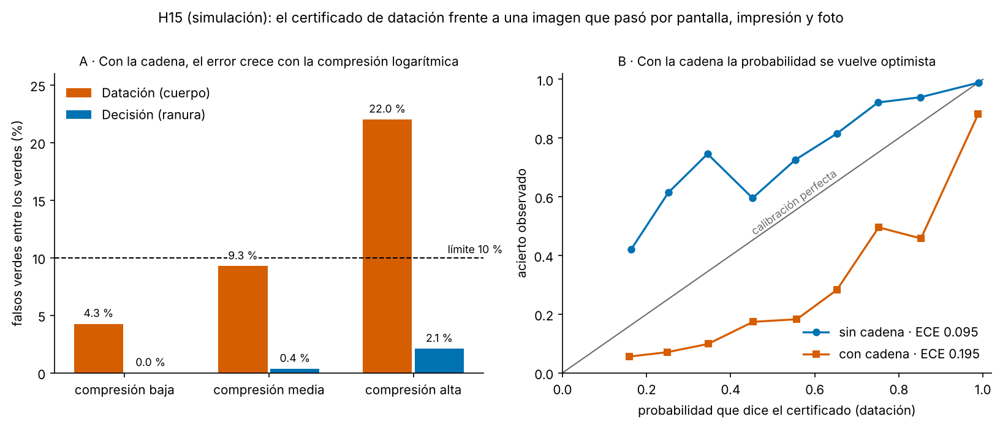

# Resultados v0.7 — la rama de imagen 2D real y la prueba de esfuerzo H15

> Solo investigación y educación. **H15 es simulación**: fantomas sintéticos y una cadena pantalla → impresión → foto que
> escribí yo, con rangos supuestos. Ninguna imagen de personas ni de animales entra en estos números. Reglas fijadas en
> `docs/PREREGISTRO_H15.md` (commit eebe7f2, después de un piloto pequeño y antes de generar ninguna imagen de confirmación).
> Confirmación: semilla 20261216, código limpio en eebe7f2 (`results/summary/h15_conf_manifest.json`); modelos congelados de H14
> sin recalibrar (SHA-256 `676c7c84…b7aeb97`). El análisis se hizo con `scripts/analyze_h15.py`, ejecutado una vez.

## 1. Resumen honesto

* **El certificado de datación (edad por la longitud cráneo-nalga, CRL) no es robusto a una imagen que pasó por la cadena.** Con la
  cadena, 11.9 % de los verdes son falsos (IC 95 % 9.7–14.1 %) frente a 1.2 % sin cadena sobre **los mismos casos**. Por la regla
  fijada de antemano el veredicto es **no concluyente** (el IC contiene el 10 %), no «no apoyada»; pero la estimación puntual
  supera el límite y la calibración sí falla con claridad (H15c).
* **La probabilidad que declara ese certificado se vuelve optimista.** Sin cadena era pesimista (dice 0.78, acierta 0.88); con cadena
  dice 0.78 y acierta **0.58**. ECE 0.195 [0.175–0.214] frente al límite de 0.10.
* **El certificado no se entera.** Con la cadena da 776 luces verdes; sin ella, 774. La imagen empeora y el semáforo no cambia:
  eso es lo que lo vuelve peligroso, más que el nivel del error.
* **El error crece con la compresión logarítmica** (exploratorio): 4.3 %, 9.3 % y 22.0 % de falsos verdes en los tercios de compresión
  baja, media y alta.
* **El certificado de decisión (ranura, el sustituto del umbral de translucencia nucal) sí aguanta**: 0.8 % de falsos verdes
  [0.2–1.4], ECE 0.026.
* Lo que esto justifica en el código: `geovida real2d` no pone nunca verde sobre imagen real, y el informe lo explica (§7).

## 2. Resultados confirmatorios (reglas de antemano)

| Hipótesis | Resultado | Veredicto |
|---|---|---|
| **H15a** Datación con cadena: falso verde ≤ 10 % | 776 verdes de 1 500; **11.86 %** [9.70–14.12] | **no concluyente** |
| **H15b** Decisión con cadena: falso verde ≤ 10 % | 862 verdes de 1 500; **0.81 %** [0.24–1.44] | **apoyada** |
| **H15c** Calibración con cadena: ECE ≤ 0.10 en cuerpo **y** ranura | cuerpo **0.195** [0.175–0.214] (n = 1 485); ranura **0.026** [0.020–0.037] (n = 980) | **no apoyada** (falla el cuerpo) |
| **H15d** Efecto de la cadena sobre la medida (descriptiva) | ver §3 | sin criterio |
| **H15e** Control `otsu` (descriptiva) | cuerpo 4.0 % [0.9–8.1] de 100 verdes; ranura 0 verdes | cuerpo apoyada; ranura **no evaluable** |

Matices que importan:

* **«No concluyente» no es «robusto».** El límite inferior del IC (9.7 %) queda apenas bajo el 10 %. Con la ECE de 0.195 y el
  patrón por compresión, la lectura prudente es la de la tabla de decisión del preregistro: **no usar este certificado sobre fotos
  de impresiones**.
* **Sin cadena la calibración ya estaba cerca del límite en el cuerpo** (ECE 0.095; ranura 0.007). Con cadena el cuerpo se
  duplica.
* **H15e** (`otsu`, control): el cuerpo cumple porque casi no da verdes (100 de 1 500); la ranura no llega a 30. No es una buena noticia
  para `otsu`: es que ese segmentador casi nunca certifica.

## 3. H15d — cuánto cambia la medida la cadena (mismos casos, `smoothed_otsu`)

| Tipo | Mediana | Media | Percentil 5 | Percentil 95 | |Cambio| mediano / SD del modelo |
|---|---|---|---|---|---|
| Cuerpo (CRL) | +1.2 % | +3.4 % | 0.0 % | +13.9 % | 1.0 |
| Ranura (NT) | −3.9 % | +3.1 % | −21.6 % | +72.5 % | 1.2 |

* En el cuerpo el cambio mediano es pequeño, pero equivale a **una desviación del modelo de error**: el modelo de H14 no la
  incluye, y la cola (hasta +14 %) es donde caen los falsos verdes.
* La ranura se mueve más en porcentaje (es un hueco pequeño), y aun así su certificado aguanta. No investigué por qué; no lo atribuyo a
  nada concreto.
* Verdes con cadena / sin cadena: cuerpo 776/774 (1.00); ranura 862/904 (0.95).
* El control `otsu` mueve el cuerpo +4.8 % en mediana (media +12.8 %; percentil 95 +47 %).

## 4. Exploratorio — falsos verdes por tercio de compresión logarítmica

| Tipo | Compresión baja | Media | Alta |
|---|---|---|---|
| Cuerpo | 4.3 % (11/258) | 9.3 % (24/259) | **22.0 %** (57/259) |
| Ranura | 0.0 % (0/296) | 0.4 % (1/280) | 2.1 % (6/286) |

Los tercios son de la propia muestra, definidos antes de mirar el resultado (están en el preregistro §5) pero **sin criterio de
éxito**. No tengo una prueba del mecanismo: que la compresión desplace el umbral de segmentación y alargue el objeto es una
hipótesis razonable, no un hallazgo.

## 5. Predicciones escritas de antemano

| Predicción | Prob. | Pasó |
|---|---|---|
| H15a apoyada | 30 % | no |
| H15a no concluyente | 55 % | **sí** |
| H15b apoyada | 85 % | **sí** |
| H15c apoyada (cuerpo y ranura) | 35 % | no |
| Cambio mediano del cuerpo ≥ +1.0 % | 55 % | **sí** |
| H15e ranura no evaluable | 80 % | **sí** |

Del lado correcto 6 de 6; puntuación de Brier 0.113 (menor es mejor; decir siempre 50 % daría 0.25). Seis predicciones no
permiten decir que calibro bien.

## 6. Qué se concluye (decidido de antemano)

| Pregunta | Respuesta |
|---|---|
| ¿Resiste la datación certificada una foto de una impresión? | **No** (no concluyente en falsos verdes; no apoyada en calibración). |
| ¿Resiste la decisión sobre el umbral? | Sí, en esta cadena simulada. |
| ¿Qué se hace? | No usar el certificado de datación sobre fotos de impresiones. Nueva hipótesis **H16** (no iniciada): (a) inflar la incertidumbre según la cadena, (b) exigir la imagen en bruto (DICOM) o (c) linealizar una curva de compresión conocida. |

Ojo con (a): calibrar contra **mi** cadena no garantiza nada sobre la de un equipo real; solo mostraría que, en simulación, el
costo de cubrir el riesgo es perder luces verdes. (b) y (c) necesitan información que una foto de impresión no tiene.

## 7. Lo que cambió en el código por este resultado

* El informe de `geovida real2d` advierte, arriba y en los supuestos, que sobre una foto de una impresión el `light_if_simulation_held`
  **no es confianza**; la prueba está en `tests/test_real2d.py`.
* El tope «nunca verde sobre imagen real» queda justificado con datos y no solo por principio.

## 8. Estado de la rama de imagen real (`geovida real2d`)

* Listo: escala desde regla/marcas, ROI revisable, medida con modelo congelado por desenfoque en mm, control de calidad,
  privacidad (SHA-256 solo; sin EXIF; informe fuera del repositorio), `--human` con nota de autorización como declaración sin verificar.
* **Sin medir ninguna imagen real todavía**: el piloto n = 1 está preregistrado (`docs/PREREGISTRO_REAL2D_PILOTO.md`) y espera la foto,
  que no llegó a esta sesión. Ver `docs/RUTA_DE_VALIDACION_REAL.md` para las compuertas G0–G4 y los tamaños de muestra necesarios
  (0 errores graves en 29 certificados verdes, 1 en 46, 2 en 61).
* H15 se aplica de lleno a ese piloto: la imagen es una foto de una impresión. Lo que sí informa es la longitud y su diferencia con
  la impresa; el semáforo, no.

## 9. Qué no se puede concluir

* Es simulación y la cadena es mía. Que el certificado falle aquí **no** dice cuánto falla con una ecografía real ni con un equipo concreto.
* El certificado se consultó con el desenfoque verdadero; con una foto real el desenfoque no se conoce.
* Nada sobre exactitud diagnóstica ni sobre la salud de nadie.
* H15 no valida el método: solo muestra una condición bajo la cual **no** hay que fiarse de él.

## 10. Desviaciones del preregistro

* `scripts/analyze_h15.py` y `scripts/figure_h15.py` se escribieron después de generar los datos y antes de ver ningún resultado; se
  ejecutó el análisis una vez. Las reglas (§5 del preregistro) no cambiaron.
