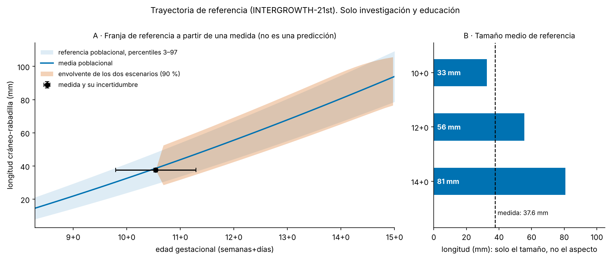

# Resultados v0.8 — primer piloto con una ecografía 2D real (n = 1) y la rama de trayectoria de referencia

> Solo investigación y educación. **El piloto es de una sola imagen y no valida nada.** La imagen la aportó el usuario el
> 12-11-2026 con la **declaración, sin verificar, de que tiene el permiso legal**. Nada identificable (nombres, fechas,
> clínica, la imagen, recortes, superposición) está en el repositorio ni en GitHub; esos archivos quedaron fuera.
> Protocolo: `docs/PREREGISTRO_REAL2D_PILOTO.md` (commit 599fdd0 fijó escala, región y segunda lectura **antes** de correr la medida automática).

## 1. Resumen honesto

* **Sobre una imagen real, la longitud cráneo-nalga (CRL) medida automáticamente es 37.57 mm; el equipo imprimió 37.4 mm** (+0.17 mm, +0.5 %).
  El control de calidad no marcó ningún problema y la medida no se movió al cambiar de segmentador ni al desplazar la región.
* **Eso no es una validación.** Es una imagen; la escala sale de un supuesto que no se puede verificar desde la imagen (10 mm entre marcas);
  no sé quién midió la cifra impresa ni cómo; y la imagen es una foto de una hoja impresa con mapa de color naranja, una cadena que la
  hipótesis H15 mostró (en simulación) que vuelve optimista al certificado de datación.
* **El semáforo no sale verde, por diseño.** La simulación habría dado verde en 3 de 6 filas de desenfoque; con H15 delante, eso no se
  lee como confianza.
* **Mis predicciones sobre el piloto fueron malas**: 3 de 6 del lado correcto (Brier 0.31; decir siempre 50 % daría 0.25). Fui más pesimista
  que lo observado en tres de ellas (§2.3). Con una imagen, eso no dice nada del método.
* **Rama nueva: `geovida trajectory`.** Muestra dónde cae el tamaño de **referencia poblacional** en las semanas siguientes, con la
  incertidumbre de la medida y de la edad propagada. **No predice cómo crecerá ni cómo se verá ningún feto**: con una medida no se puede, y
  el tamaño de referencia no determina el aspecto (§4). Solo se calcula dentro del rango de la fuente (58–105 días).

## 2. Piloto REAL2D (n = 1)

### 2.1 Qué se hizo

De la hoja con tres capturas se midió solo la de la CRL. Las otras dos (Doppler del latido; otra estructura) no se midieron.
Escala: 12 marcas de profundidad igualmente espaciadas (26–27 px) tomadas de la propia captura, supuestas de 10 mm. Región: fijada a ojo antes de medir.
Medida: `geovida real2d` con `smoothed_otsu`, modelo congelado de H14, rejilla de desenfoque de 0.25 a 2 mm.

### 2.2 Resultados

| Cantidad | Valor |
|---|---|
| Medida nativa (Feret de la máscara) | **37.57 mm** (101.4 px a 0.3704 mm/px) |
| Medida por fila de desenfoque (0.25 a 2 mm) | 37.48–37.68 mm; seis filas dentro de la caja calibrada |
| Corregida por el sesgo del modelo | 36.88–37.53 mm |
| Impresa por el equipo | 37.4 mm (diferencia +0.17 mm sobre la nativa; +0.24 mm, +0.6 %, sobre el promedio de las filas) |
| Segunda lectura (calibrador manual, a ojo) | 36.73 mm (99.2 px) |
| Control de calidad | no toca el borde; 1 componente grande; contraste/ruido 8.9 |
| Semáforo | amarillo en cinco filas, rojo en la de 2 mm; **nunca verde** (tope de imagen real) |
| Edad por la fórmula INTERGROWTH-21st (informativa) | 73.8 d = 10+4, dispersión biológica ±3.1 d |

**Sensibilidad (descriptiva; no cambia el resultado primario; `scripts/real2d_sensibilidad.py`):**

| Qué se cambia | Longitud |
|---|---|
| Escala por mínimos cuadrados en vez de la mediana de espaciados | 38.19 mm (+2.1 % sobre la impresa) |
| Segmentador `otsu` en vez de `smoothed_otsu` | 37.57 mm (igual) |
| ROI desplazada ±6 px en los cuatro lados (16 variantes) | 37.57 mm en todas |
| Un píxel en cada extremo | ±0.37 mm cada uno |

Lo que más mueve la medida es la **escala** (1.6 % entre dos formas razonables de calcularla) y el **supuesto de 10 mm**, no la segmentación. La
coincidencia de la edad con la impresa (10+4) es la misma que daría cualquier CRL cercana: no aporta una comprobación independiente.

### 2.3 Predicciones escritas de antemano (`docs/PREREGISTRO_REAL2D_PILOTO.md` §4)

| Predicción | Prob. | Ocurrió |
|---|---|---|
| La medida impresa es legible y sirve de referencia | 60 % | **sí** |
| La escala se puede derivar de las marcas | 65 % | **sí** (con el supuesto de 10 mm) |
| Al menos una fila cae dentro de la caja calibrada | 85 % | **sí** (las seis) |
| La medida automática queda a ≤ 10 % de la impresa | 40 % | **sí** (0.5 %) |
| Alguna fila sale verde en simulación | 10 % | **sí** (tres) |
| El control de calidad marca al menos un problema | 60 % | no |

### 2.4 Qué se puede y qué no se puede decir

* **Se puede decir:** en esta imagen, el programa recuperó la cifra que el equipo imprimió con una diferencia del orden de un píxel, y esa cifra
  resistió al cambio de segmentador y de región. La canalización funciona de punta a punta sobre una imagen real: escala, región, medida, informe, privacidad.
* **No se puede decir:** que el método sea exacto en ecografía real, que su error esté calibrado, que sirva para otro equipo u otra edad,
  ni nada sobre la salud o la edad de nadie. Una diferencia pequeña en un caso puede ser azar o compensación de errores.
* **Límites propios de esta imagen:** (1) el mapa de color no se probó en ninguna simulación; (2) es una foto de una impresión, el caso en que H15 vio que el
  certificado de datación falla; (3) la segunda lectura la hizo el asistente sabiendo la cifra impresa, no es independiente ni de un ecografista;
  (4) la CRL impresa no tiene operador ni protocolo conocidos.
* **Lo que daría peso:** más imágenes (cada una con su autorización), imagen en bruto del equipo en vez de foto de impresión, y al menos dos lectores
  independientes. Ruta y tamaños de muestra: `docs/RUTA_DE_VALIDACION_REAL.md` (por ejemplo, 29 certificados verdes sin ningún error grave para acotar el fallo).

## 3. Cambios en el código y los documentos

* `scripts/real2d_sensibilidad.py` (nuevo, genérico: la imagen se pasa por la línea de órdenes y solo se imprime un JSON de números).
* `src/geovida/trajectory.py`, `geovida trajectory`, `tests/test_trajectory.py` (15 pruebas), `scripts/figure_trajectory.py`.
* Versión 0.8.0.dev0 (en `pyproject.toml` y `geovida.__version__`, que una prueba compara).

## 4. Rama de trayectoria de referencia (`geovida trajectory`)

**La idea del usuario:** subir la ecografía y ver, de forma visual, cómo se desarrollará el bebé y cómo será un poco más grande.

**Lo que la evidencia sostiene, y esto hace el módulo:** con una medida se puede mostrar dónde cae el **tamaño de referencia poblacional** en semanas
posteriores. Usa las ecuaciones de INTERGROWTH-21st (Papageorghiou et al. 2014; 4 265 mujeres; CRL media = −50.6562 + 0.815118·GA + 0.00535302·GA², SD = −2.21626 + 0.0984894·GA;
GA en días, 58 a 105), leídas el 12-11-2026 en el texto de acceso abierto y comprobadas contra su Tabla 2 (las medias semanales coinciden con la ecuación dentro de 2 mm; es una comprobación de
consistencia, no de igualdad). Propaga el error de la medida y la incertidumbre de la edad, y muestra dos escenarios extremos (el feto conserva su puntuación z / la pierde del todo).
Para la CRL medida (37.6 mm, error declarado 2 %) y la edad estimada con esa misma CRL (10+4 ± 5 d), la envolvente al 90 % es:

| Días después | Edad | Media poblacional | Envolvente (mm) |
|---|---|---|---|
| 7 | 11+4 | 50.1 mm | 37.6–63.3 |
| 14 | 12+4 | 62.2 mm | 48.5–76.5 |
| 21 | 13+4 | 74.7 mm | 59.9–90.2 |
| 28 | 14+4 | 87.8 mm | 71.8–102.6 |

**Lo que NO hace, y por qué:**

* **No predice el aspecto.** El tamaño de referencia no determina rasgos faciales ni el aspecto del bebé; una ecografía de primer trimestre no contiene esa información.
  La figura muestra solo longitudes, nunca una imagen del feto agrandada (las proporciones cambian con la edad).
* **No predice el crecimiento de ese feto.** Con una sola medida y una edad estimada con esa misma medida, el tamaño cae en la mediana por construcción y no dice si el feto es grande o pequeño
  para su edad. La franja es ancha a propósito (más de ±12 mm a las dos semanas).
* **Los dos escenarios no están validados.** La correlación entre el tamaño de una visita y el de la siguiente no la conozco. **H17** (`docs/PREREGISTRO_H17.md`) pide datos seriados reales para medirla.
* **No hay uso clínico** y se niega a calcular fuera de 58–105 días (8+2 a 15+0).

## 5. Hipótesis nuevas (sin resultados)

* **H17 — ¿La envolvente de dos escenarios cubre la CRL futura observada?** Preregistrada, **pendiente de datos seriados reales**.
* **H16** (de v0.7, sin iniciar): inflar la incertidumbre según la cadena pantalla–impresión–foto, o exigir la imagen en bruto del equipo.

## 6. Qué no se puede concluir

* Nada clínico. Nada sobre exactitud en ecografía real.
* El piloto es n = 1, con escala supuesta, referencia de operador desconocido y una cadena de imagen que el protocolo no contemplaba (mapa de color).
* La trayectoria es una franja de referencia poblacional, no una predicción individual.

## 7. Desviaciones

* El preregistro del piloto (§2 y §3) no preveía el mapa de color ni que la imagen fuera una hoja con tres capturas; se añadieron como límites en §7 de ese documento, antes de medir.
* La región (ROI), la escala y la segunda lectura se fijaron mirando la imagen, antes de correr la medida automática; la segunda lectura se puso sabiendo la cifra impresa (declarado).
* En una prueba de `tests/test_trajectory.py` escribí mal una cota (el ancho esperado del intervalo de edad); la corregí a partir de la fórmula antes de cualquier commit.
